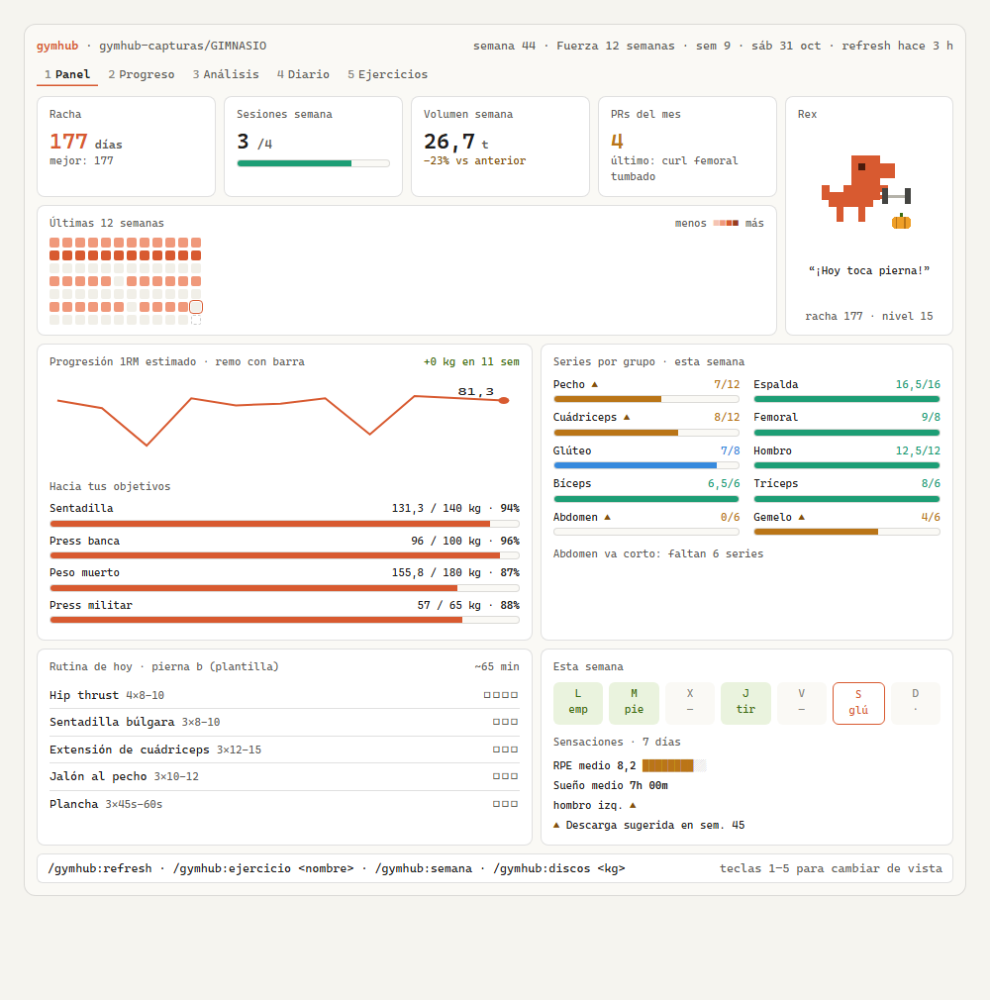
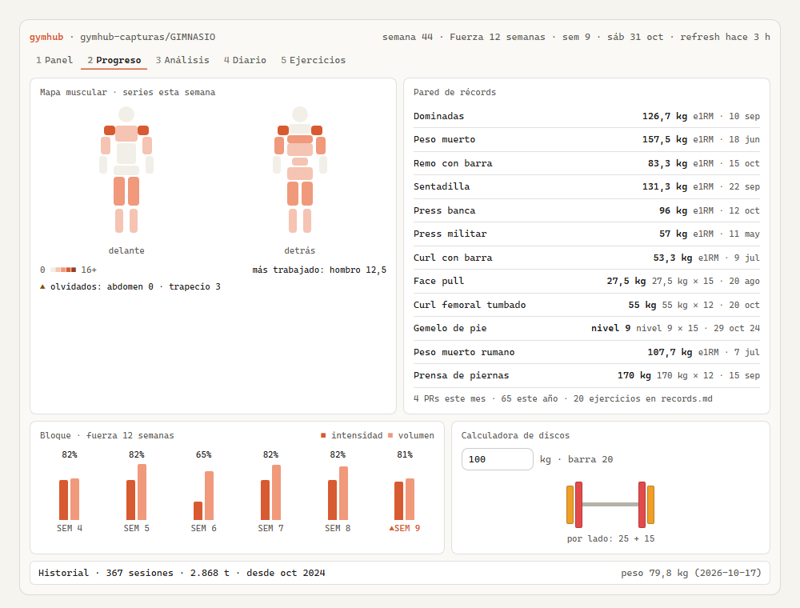
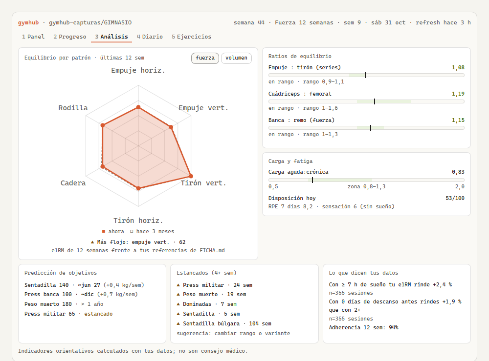
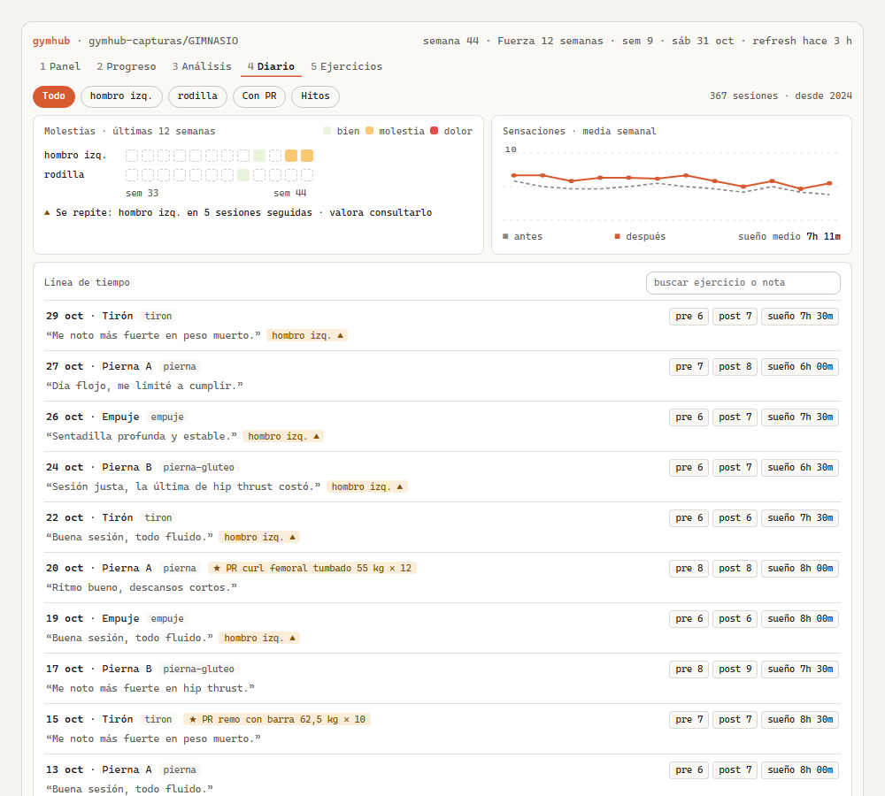
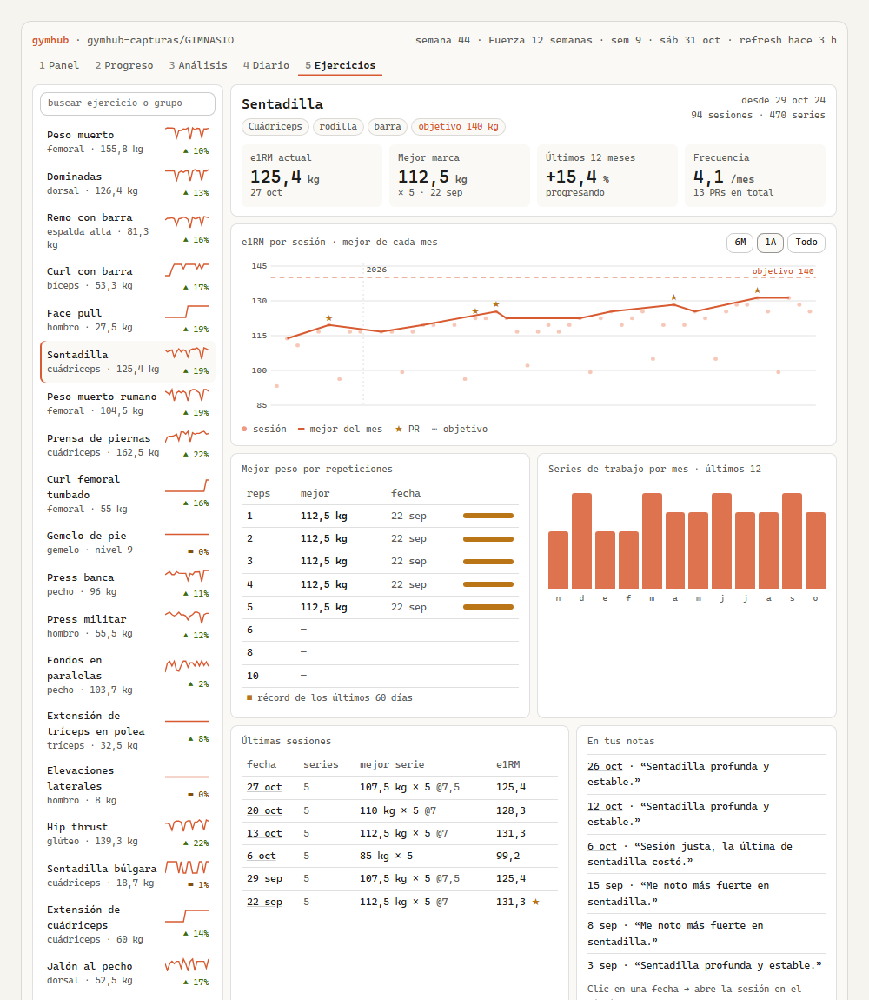
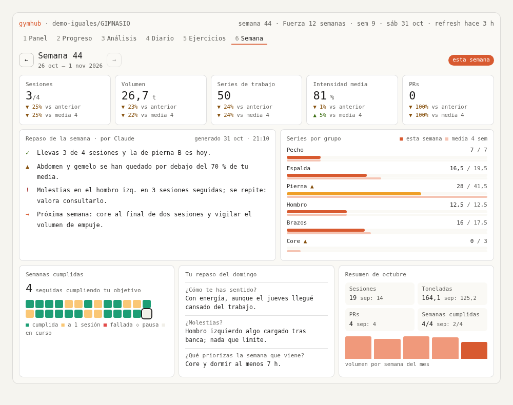
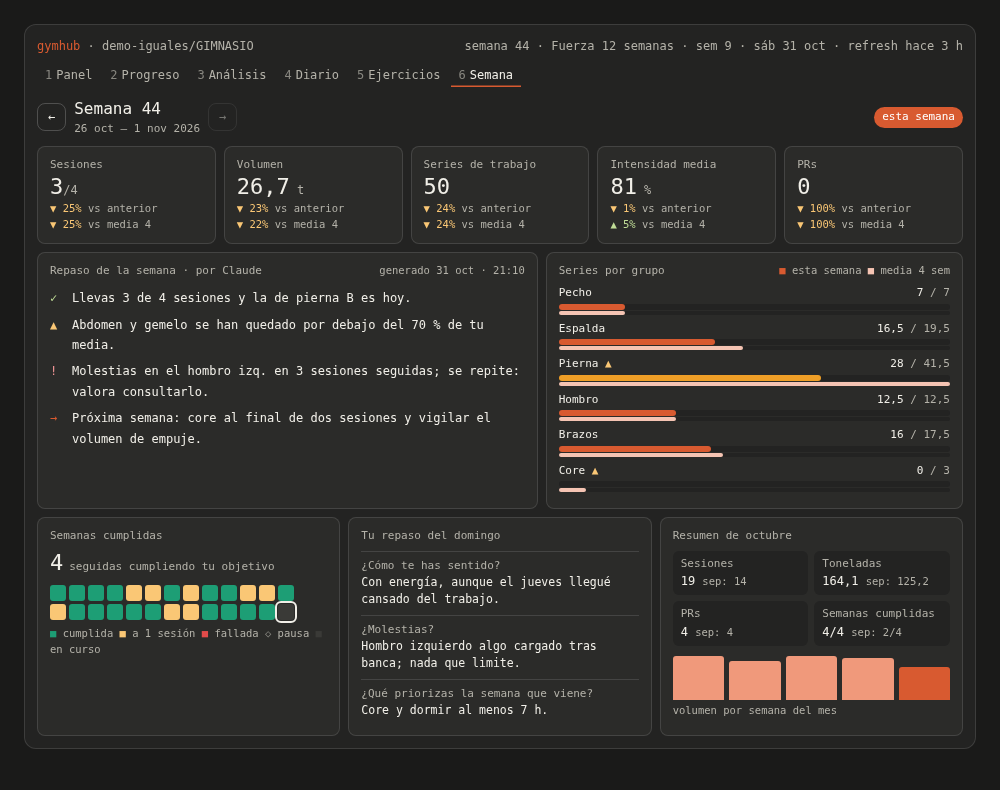
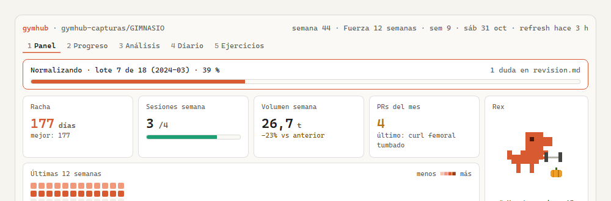

# gymhub

**Tu registro de gimnasio, vivo y local.** Escribe tus entrenos como quieras, Claude los ordena y tu web local te enseña cómo vas.

gymhub es un plugin de Claude Code con una web local como interfaz, pensada para revisar tu progreso en casa. Tienes una carpeta de gimnasio en tu ordenador y dejas tus entrenos en `CONTEXTO/`: notas del móvil, un export de un chat, el CSV de una app, la foto de una libreta… En el formato que sea. Con `/gymhub:refresh`, Claude los convierte en un historial ordenado en Markdown, y tu web se actualiza en directo mientras lo hace.



<sub>Todas las capturas usan un historial inventado.</sub>

## Cómo funciona

- **En Claude Code hablas:** importas, registras series, preguntas, pides análisis.
- **En el navegador miras:** la web se actualiza sola, sin recargar, cada vez que Claude termina algo.
- **Sin servidor ni nube:** la web es un fichero local que lee tus datos locales.
- **La IA normaliza y el código calcula:** Claude pasa lo que escribes a un formato estándar. Las cifras (e1RM, volumen, récords, rachas, análisis) las calcula siempre un script, nunca Claude de memoria.

## Qué incluye

- **Panel:** racha, sesiones y volumen de la semana, PRs del mes, calendario de 12 semanas, progresión del e1RM, objetivos, series por grupo, rutina de hoy, sensaciones y aviso de descarga.
- **Progreso:** mapa muscular, pared de récords, evolución del bloque, calculadora de discos e historial total.
- **Análisis:** radar de equilibrio por patrón de movimiento (fuerza o volumen), ratios empuje:tirón, cuádriceps:femoral y banca:remo, carga aguda:crónica, disposición del día, predicción de objetivos, ejercicios estancados y lo que dicen tus datos (por ejemplo, cómo te afecta dormir poco).
- **Diario:** tus notas y sensaciones en una línea de tiempo, molestias por zona semana a semana e hitos (PRs, cambios de programa, pausas, primeras veces).
- **Ejercicios:** la ficha de cada ejercicio con todo su historial: progresión desde el primer día, tu mejor peso para cada número de repeticiones, últimas sesiones y lo que has escrito sobre él.
- **Semana:** la revisión del fin de semana. Sesiones, volumen, series, intensidad y PRs frente a la semana anterior y a tu media de 4 semanas. Además, el repaso de Claude y tus respuestas de `/gymhub:semana`, las series por grupo, tu racha de semanas cumplidas y el resumen del mes. Te mueves entre semanas con las flechas.
- **Importación en directo:** durante un `/gymhub:refresh` ves el avance lote a lote, y las gráficas y los récords crecen mientras se importa.
- **Tu historial en Markdown:** una ficha por sesión, legible y editable, con el texto original guardado. Nada se pierde.
- **Rex,** un pequeño compañero de píxeles que entrena contigo.

| Progreso | Análisis |
|---|---|
|  |  |
| **Diario** | **Ejercicios** |
|  |  |
| **Semana** | **Semana (tema oscuro)** |
|  |  |

## Requisitos

- Claude Code (en la terminal o en la pestaña Code de la app de escritorio).
- **Node.js 20 o superior.** Los scripts no usan ninguna dependencia, pero necesitan Node.
- Un navegador: Edge, Chrome, Brave o Firefox.
- Linux, macOS o Windows con WSL.

## Instalación

1. Crea tu carpeta de gimnasio y abre Claude Code en ella:
   ```bash
   mkdir -p /mnt/d/GIMNASIO && cd /mnt/d/GIMNASIO && claude
   ```
2. Instala el plugin **solo para esta carpeta**, así el resto de tus sesiones de Claude Code siguen como siempre. En el prompt:
   ```
   /plugin install gymhub --marketplace Diego303/gymhub
   ```
   y elige el alcance de proyecto. O, desde la shell, dentro de la carpeta:
   ```bash
   claude plugin install gymhub --marketplace Diego303/gymhub --scope project
   ```
3. Ejecuta `/gymhub:configurar`. Crea la estructura, te pregunta tus objetivos (todo opcional) y abre tu web.

**Paso a paso, del primer día a la rutina de cada semana:** [instrucciones.md](instrucciones.md).

Fuera de esa carpeta el plugin queda desactivado. También funciona instalado para todas tus sesiones (`--scope user`), porque los comandos actúan sobre la carpeta configurada.

## Uso

**Importar tus entrenos** (también tu historial antiguo):

1. Copia lo que tengas en `CONTEXTO/`: `.md`, `.txt`, el CSV de una app, un export de Telegram o WhatsApp, o fotos.
2. Ejecuta `/gymhub:refresh` y mira la web: verás el avance y tus datos apareciendo.
3. Si hay dudas (fechas raras, ejercicios ambiguos), quedan en `revision.md`. Repásalas con `/gymhub:revision`.



Da igual cómo lo apuntes: `3x10 50kg`, `50x10x3`, `10 - 50 kg x 3`, `bench 3x5 @ 185 lb RPE 8`, `pin 7`, `PC+10`, `7,5 kg`, `12'5`, en español o en inglés. Claude lo pasa todo a un formato estándar común.

La primera vez, gymhub aprende cómo apuntas tú y lo guarda en `convenciones.md`: el orden de las fechas, tus abreviaturas, qué significa «nivel 7» en tus máquinas… Cada duda general te la pregunta una sola vez, y a partir de ahí lo aplica siempre igual.

**Una semana normal:** entrenas y apuntas como siempre (en tu libreta, en el móvil, donde sea). Al llegar a casa, lo dejas en `CONTEXTO/`, haces `/gymhub:refresh` y revisas en la web cómo vas. El fin de semana, `/gymhub:semana`: Claude te hace tres preguntas (cómo te has sentido, molestias, qué priorizas) y deja el repaso en la pestaña Semana. Si haces `/gymhub:refresh` en sábado o domingo y aún no has hecho el repaso, te lo recuerda.

### Comandos

Los comandos de un plugin llevan su nombre delante: `/gymhub:refresh`. **Truco:** escribe `/refre` y pulsa Tab, y se completa solo. Sin argumentos, escribir `/refresh` y pulsar Enter también funciona.

| Comando | Para qué |
|---|---|
| `/gymhub:web` | Abre tu web |
| `/gymhub:refresh` | Importa lo que haya en `CONTEXTO/` y actualiza todo (la web lo muestra en directo) |
| `/gymhub:panel` · `/gymhub:progreso` · `/gymhub:analisis [fuerza\|volumen]` · `/gymhub:diario [zona o ejercicio]` | Llevan la web a esa vista, por ejemplo `/gymhub:diario rodilla` |
| `/gymhub:ejercicio <nombre>` | Resumen de un ejercicio en el chat y su ficha en la web |
| `/gymhub:semana [AAAA-Www]` | Repaso de la semana: 3 preguntas y el resumen en `semanas/AAAA-Www.md`, que se ve en la pestaña Semana |
| `/gymhub:discos <kg>` | Qué discos poner en cada lado |
| `/gymhub:revision` | Resolver las dudas de la importación |
| `/gymhub:carpeta [ruta]` | Ver o cambiar dónde está tu carpeta de gimnasio |
| `/gymhub:configurar` | Configuración inicial |
| `/gymhub:entreno` · `/gymhub:serie "…"` · `/gymhub:fin` | Opcional: registrar en vivo desde el terminal (rutina, calentamiento, cuenta atrás del descanso) |

También puedes hablarle a Claude con normalidad («apunta que hoy hice banca 3x5 a 80», «¿cómo voy en sentadilla?»). La skill de gymhub sabe guardar la sesión y buscar tus cifras.

### La web

- Se abre con `/gymhub:web` y se queda abierta: relee tus datos cada segundo y repinta solo lo que cambia.
- Teclas `1` a `6` para cambiar de vista; `Esc` para salir de un campo de texto. En la pestaña Semana, las flechas `←` `→` cambian de semana (y su dirección es `#semana/2026-W44`).
- Los comandos de vista cambian la pestaña que ya tienes abierta. Solo abren otra si gymhub no ha abierto la web en las últimas 12 horas.
- Tema claro u oscuro según tu sistema. En el móvil, en una sola columna, si abres el fichero.

## Tu carpeta

```
GIMNASIO/
├─ CONTEXTO/        bandeja de entrada (lo importado pasa a CONTEXTO/procesado/)
├─ FICHA.md         tus objetivos, lesiones y referencias
├─ convenciones.md  cómo apuntas tú (lo aprende gymhub y lo puedes editar)
├─ ejercicios.md    catálogo de ejercicios y sus alias (unos 125 de partida)
├─ sesiones/        una ficha por sesión, por años
├─ records.md       tus PRs (calculados) y marcas declaradas
├─ eventos.md       pausas declaradas e hitos
├─ plantillas/      tus rutinas (opcional)
├─ semanas/         resúmenes semanales
├─ revision.md      dudas pendientes
└─ .gymhub/         datos calculados y tu web (se pueden regenerar)
   └─ web/dashboard.html
```

- Puedes editar cualquier sesión a mano: gymhub nunca sobrescribe tus cambios.
- El detalle del formato está en [`docs/FORMATO.md`](docs/FORMATO.md).

## Privacidad

Tus datos y tu web viven en tu carpeta, en tu ordenador. gymhub no tiene servidor ni nube, y la web no hace ninguna petición a internet. Lo único que sale de tu máquina es lo que Claude procesa en tu propia sesión de Claude Code.

gymhub registra molestias y lesiones, pero no da consejo médico. Las métricas de Análisis son orientativas y se calculan solo con tus datos.

## Notas para WSL

- Usa rutas de WSL (`/mnt/d/GIMNASIO`). Si escribes `D:\GIMNASIO`, gymhub lo traduce.
- Mejor tener la carpeta en un disco de Windows (`/mnt/c`, `/mnt/d`…), para que el navegador la abra directamente. Dentro de WSL también funciona, por `\\wsl.localhost`.
- La web se abre en tu navegador predeterminado de Windows. El aviso de fin de descanso sale como notificación de Windows (se desactiva con `"aviso_descanso": false` en `~/.config/gymhub/config.json`).

## Desarrollo

```bash
pnpm install           # solo herramientas de desarrollo (Playwright para probar la web)
pnpm test              # tests del núcleo, la importación y los cálculos
pnpm test:web          # la web en Chromium y Firefox de verdad (Playwright)
pnpm test:e2e          # la web en Chromium: cifras, recarga en vivo, XSS, diseño, teclado y rendimiento
pnpm test:visual       # capturas de referencia por vista (test/visual/), en claro y oscuro
pnpm test:rendimiento  # 5 años inventados: métricas < 2 s y datos.js < 1 s
pnpm test:todo         # todo lo anterior (y la suite en 3 zonas horarias), en orden
pnpm lint              # la web no hace peticiones de red + validación del plugin
pnpm demo <carpeta>    # una carpeta con 2 años de historial sintético para ver la web
pnpm qa:validar -- --datos <carpeta>   # valida una carpeta en solo lectura (recuentos y fichero:línea)
claude --plugin-dir .  # probar el plugin sin instalarlo
```

- Usa pnpm, no npm ni yarn.
- Los tests usan solo datos sintéticos (`tests/fixtures/`): no subas nunca datos reales de entrenamiento.
- El plan y el informe de QA están en [`docs/QA-PLAN.md`](docs/QA-PLAN.md) y [`docs/QA-INFORME.md`](docs/QA-INFORME.md).
- `node scripts/e2e-persona.mjs <persona>` importa una de las 5 personas sintéticas con Claude de verdad y compara el resultado con lo esperado.
- El diseño de la web está en [`docs/maquetas/`](docs/maquetas/) y las decisiones técnicas en [`docs/notas-tecnicas.md`](docs/notas-tecnicas.md).

## Licencia

MIT
